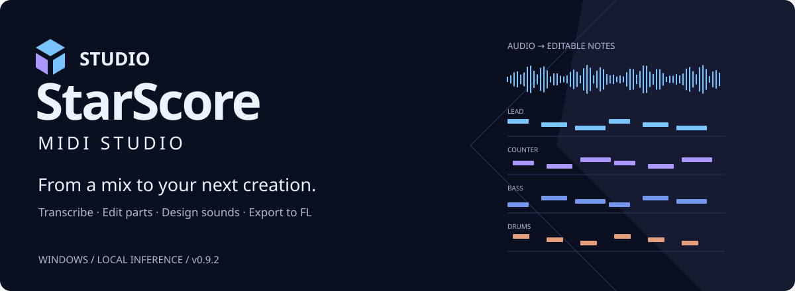

**Offline workspace · Bring your own models · Local audio workflow**

[简体中文](README.md) · **English** · [Windows download](https://github.com/TEnDayF/StarScore-Framework/releases/latest)

## Download and open

Download **StarScore-0.10.1-Windows-x64.zip** from Releases, extract the entire folder and double-click **StarScore.exe**. The workspace starts without internet, a Python installation or terminal commands. Keep the runtime and application files beside the executable.

**No models are included.** Editing existing StarScore projects and MIDI export are available independently of inference. Transcription requires your own MuScriptor GGUF, native bridge engine and FFmpeg. UMXHQ additionally requires four weights and a separate Python environment with requirements-separation.txt. Vital playback requires your own Vital VST3 and the optional requirements-vital.txt environment.

## Configure

Press **Ctrl+, → Models and engines**, follow the official upstream links and select local files. Check models/adapters and test FFmpeg, then save. Unlinking never deletes a model. Missing dependencies produce actionable messages without clearing the queue. Change language under Settings → Transcription/output and restart.

MuScriptor models remain subject to their upstream non-commercial terms. Framework GPL licensing does not replace model licensing. HTDemucs is an informational upstream reference only, without a supported adapter.

## Limits

This is a research preview, not a promise to recover the original score or effects chain. Windows playback format support depends on OS codecs. The bundled basic audio library supports WAV/AIFF; compressed-audio transcription uses user-configured FFmpeg.

Factory presets and FL serialization templates are not redistributed. Save your own initialized Vital .vital file and select it in settings for preset generation. FL export requires a StarScore-specific scaffold JSON, not an arbitrary .flp; no end-user scaffold-generation wizard is supplied in this version. Without the template that optional function is unavailable; MIDI editing/export remains available.

## Developers and licensing

Windows x64 / Python 3.12: install requirements.txt and run `python main.py`. Optional separation/rendering dependencies are listed separately. Native bridge: [engine/README.md](engine/README.md). Launcher: launcher/Launcher.cs.

Only runtime application code, UI assets, launcher/bridge sources, setup instructions and license materials are published here. Development tests and private assets remain outside the public repository.

Application: [GPL-3.0](LICENSE). [Third-party notices](THIRD_PARTY.md). Replaceable dynamic runtime libraries accompany the portable package. Their sources and build instructions are supplied as **StarScore-0.10.1-Runtime-Sources.zip** on the same Release. End users do not need that source-materials archive to run the application.
