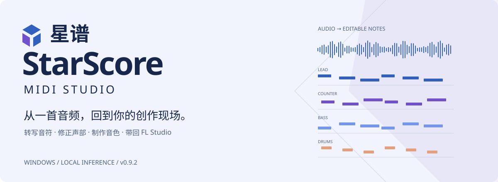

<picture><source media="(prefers-color-scheme: dark)" srcset="docs/assets/hero-dark.svg"></picture>

**离线打开工作台 · 模型自行导入 · 本地音频创作**

[简体中文](README.md) · [English](README.en.md) · [下载 Windows 应用](https://github.com/TEnDayF/StarScore-Framework/releases/latest)

  

## 下载即开

在 [Releases](https://github.com/TEnDayF/StarScore-Framework/releases/latest) 下载 **StarScore-0.10.2-Windows-x64.zip**，完整解压后双击 **StarScore.exe**。工作台启动不需要联网、安装 Python 或输入命令。不要只拖出 EXE；它需要旁边的 runtime 和源码文件。

**应用包不含模型。** 默认可以打开工作台、编辑已有 StarScore 工程和导出 MIDI。音频转写、分离、Vital 渲染与 FLP 导出，需要配置相应外部资源。缺资源时会提示具体缺项，保留已有工程和待处理队列。

| 功能 | 需要的额外资源 |
|---|---|
| 转写歌曲 | 自行下载的 MuScriptor GGUF、原生桥引擎、FFmpeg |
| 复杂来源分离 | UMXHQ 四份权重、安装了 requirements-separation.txt 的独立 Python 环境 |
| Vital 候选预设 | 自己有权使用的 Vital 初始化预设 |
| Vital 全曲渲染 | 上述预设、本机 Vital VST3、应用 Python 环境中的 Pedalboard |
| FLP 工程生成 | 相容的 FL 导出结构模板；打开工程另需 FL Studio 和 Vital |

## 设置资源

按 **Ctrl+, → 模型与引擎**。通过推荐列表访问原项目页面，阅读许可，再导入本地文件。支持 Small / Medium / Large 分别关联；校验模型及适配器后保存。FFmpeg 必须单独配置，可点击“测试 FFmpeg”。解除关联只清除路径，不删除文件。

中英文切换位于“设置 → 转写与输出”，保存后重启生效。推理后端支持自动或 CPU。模型与工具从不由本软件静默下载。

MuScriptor 模型具有非商业使用限制，独立于框架 GPL-3.0。详见[原模型页面](https://huggingface.co/DamRsn/muscriptor-gguf)及[第三方署名](THIRD_PARTY.md)。HTDemucs 只有上游参考链接，没有运行适配器。

## 当前边界

这是研究预览工作台，不承诺一键还原原曲音符、音色或完整效果链。工作台离线启动，不等于没有模型也能自动扒谱。Windows 原生播放后端支持的格式取决于系统编解码器；本包基础音频库支持 WAV/AIFF，压缩音频转写通过用户配置的 FFmpeg 转换。

本版未分发厂商初始化预设或 FL 二进制结构模板。Vital 模板可从自己的 Vital 保存初始化 .vital 后在设置中关联；FL 结构模板是 StarScore 特定 JSON schema，不是直接选择 .flp，普通用户暂不具备一键生成该模板的流程。缺少模板时，该可选功能不可用，MIDI 编辑/导出仍可使用。

## 开发者运行

Python 3.12、Windows x64：安装 requirements.txt 后运行 `python main.py`。可选分离与渲染依赖分别见 requirements-separation.txt、requirements-vital.txt。原生转写桥见 [engine/README.md](engine/README.md)。启动器源码位于 launcher/Launcher.cs。

公开仓库只保留运行源码、界面素材、启动器/桥源码、必要说明与许可证。测试、开发截图、调试工具与私人素材不在公开仓库；发布前的验证独立进行。

## 许可与源码材料

框架代码：[GPL-3.0](LICENSE)。第三方：[署名及许可说明](THIRD_PARTY.md)。Windows 包包含可替换的动态运行库；配套 **StarScore-0.10.2-Runtime-Sources.zip** 与应用包放在同一 Release，供取得运行库源码和构建说明。普通用户无需下载源码材料包即可使用应用。
